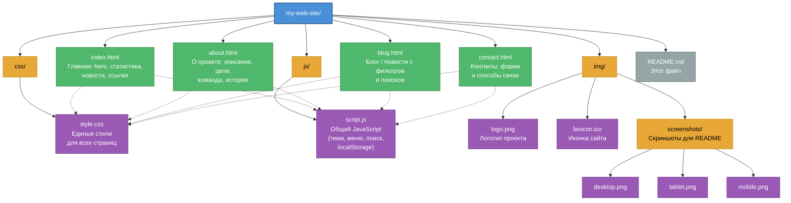

# 🎓 Luzaniny — сайт-визитка

## 📝 Описание

**Luzaniny** — учебный статический сайт-визитка, созданный в рамках самостоятельной работы по веб-разработке.

Проект демонстрирует навыки работы с чистым HTML5, CSS3 и JavaScript, а также умение вести разработку через систему контроля версий **Git** и публиковать сайт на хостинге **GitHub Pages**.

**Назначение сайта:** показать современный подход к созданию многостраничных статических сайтов без использования фреймворков и сборщиков — с адаптивным дизайном, тёмной темой, анимациями и интерактивными элементами.

---

## 🚀 Функциональность

- ✅ **Адаптивный дизайн** — корректное отображение на смартфонах, планшетах и десктопах (mobile-first, flexbox и grid).
- ✅ **Тёмная и светлая тема** — переключатель в шапке сайта, выбор пользователя сохраняется в `localStorage`.
- ✅ **Навигация между страницами** — единый header и footer на всех страницах, активная ссылка подсвечивается автоматически.
- ✅ **Поиск по контенту** — живой поиск по постам блога и названиям разделов (фильтрация в реальном времени).
- ✅ **JS-эффекты элементов дизайна:**
  - бургер-меню для мобильных устройств;
  - плавное появление секций при скролле (`IntersectionObserver`);
  - анимированные счётчики статистики на главной;
  - кнопка «Наверх» с плавной прокруткой;
  - фильтр постов блога по категориям;
  - лайки постов с сохранением в `localStorage`;
  - автосохранение черновика формы обратной связи.

---

## 📁 Структура проекта

```
my-web-site/
│
├── index.html              # Главная: hero, статистика, новости, ссылки
├── about.html              # О проекте: описание, цели, команда, история
├── blog.html               # Блог / Новости с фильтром и поиском
├── contact.html            # Контакты: форма и способы связи
│
├── css/
│   └── style.css           # Единые стили для всех страниц
│
├── js/
│   └── script.js           # Общий JavaScript (тема, меню, поиск, localStorage)
│
├── img/
│   ├── logo.png            # Логотип проекта
│   ├── favicon.ico         # Иконка сайта
│   └── screenshots/        # Скриншоты для README
│       ├── desktop.png
│       ├── tablet.png
│       └── mobile.png
│
└── README.md               # Этот файл
```

**Структура проекта**

**Описание файлов:**

| Файл / папка | Назначение |
|--------------|------------|
| `index.html` | Главная страница с описанием проекта, статистикой и быстрыми ссылками |
| `about.html` | Страница «О проекте»: цели, задачи, команда и история разработки |
| `blog.html` | Блог с новостями и поиском по контенту |
| `contact.html` | Контакты и форма обратной связи |
| `css/style.css` | Единый файл стилей: переменные, тёмная тема, адаптив |
| `js/script.js` | Общий скрипт: тема, меню, поиск, анимации, localStorage |
| `img/` | Изображения: логотип, favicon, скриншоты |

---

## 🌐 GitHub Pages

Сайт доступен по адресу:

**➡️ [Веб-сайт](https://luzaninyhsema-dev.github.io/my-web-site/)**

### Как развернуть у себя

```bash
# 1. Клонировать репозиторий
git clone https://github.com/.../...
cd my-web-site

# 2. Запустить локальный сервер (Python)
python -m http.server 8000

# 3. Открыть в браузере
# http://localhost:8000
```

> ⚠️ Не открывайте `index.html` двойным кликом — браузер заблокирует часть функций (`file://`). Используйте локальный сервер или расширение **Live Server** в VS Code.

### Публикация на GitHub Pages

1. Откройте репозиторий на GitHub → **Settings** → **Pages**.
2. В разделе *Branch* выберите `main` и папку `/ (root)`.
3. Нажмите **Save**.
4. Через 1–2 минуты сайт будет доступен по публичному URL.

---

## 👥 Разработчики

| Имя | Роль |
|-----|------|
| **Luzaniny** | Основная роль: вёрстка, стили, JavaScript, Git, документация |


---

## 🛠 Используемые технологии

- **HTML5** — семантическая разметка
- **CSS3** — Flexbox, Grid, CSS-переменные, media queries, `prefers-color-scheme`
- **JavaScript (Vanilla)** — DOM, `IntersectionObserver`, `localStorage`, `requestAnimationFrame`
- **Git** — контроль версий
- **GitHub Pages** — хостинг
- **Visual Studio Code** — редактор
- **Google Fonts (Inter)** — типографика

---

## 📄 Лицензия

Проект распространяется под лицензией **MIT**.

```
MIT License
